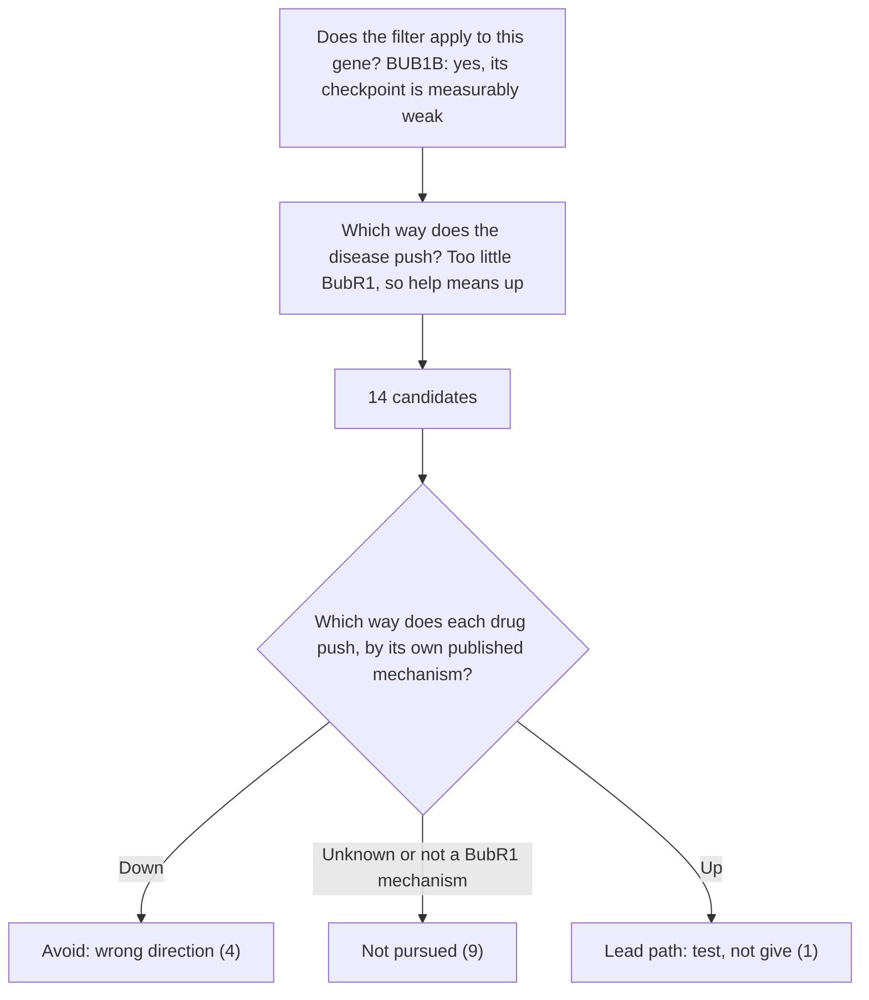

# MVA Hackathon 2026: Track 2

[](LICENSE)
[](Makefile)
[](https://github.com/pelyne/apeliny-mva-hackathon-2026-track1)

This is my Track 2 (drug repurposing) entry for the [Rare Disease, Real Kid: MVA Hackathon](https://sagebio-rare-disease-real-kid-mva-hackathon-2026.hf.space/). My Track 1 entry, which found the variants this work starts from, is in a separate repo: [apeliny-mva-hackathon-2026-track1](https://github.com/pelyne/apeliny-mva-hackathon-2026-track1).

**No patient genome or phenotype is in this repository.** The only case details used are the two public variant coordinates from my Track 1 answer. This is not medical advice, not a diagnosis, and it gives no doses.

> **Direction first, evidence second.** For a gene where the child has too little of a protein, a drug that pushes the wrong way can look like a strong candidate on paper. So I asked which way each drug pushes BubR1 before weighing any evidence.

## What this work delivers

1. A short list of drugs and drug classes marked "Avoid: wrong direction" (checkpoint, MPS1, ATR and PARP inhibitors, mitotic poisons, nicotinamide, and metformin, whose BubR1 result was seen only at high lab concentrations), because their published mechanism weakens the spindle checkpoint or targets cells with a weak one.
2. A testable path built on the NAD+/SIRT2/BubR1 axis, with nicotinamide mononucleotide (NMN) as the lead molecule to test in the child's own cells first. The report sets out five ordered steps: phase, BubR1 protein, the checkpoint phenotype, NMN in the child's own cells, then a wider screen.
3. A reusable direction filter that any team can run on any checkpoint-deficiency gene before spending money on lab work.

Standard cancer surveillance under existing MVA guidance stays exactly as it is.

- Pitch video (3 min): [youtu.be/FHZ9o7ki--Y](https://youtu.be/FHZ9o7ki--Y)
- Report: [report/apeliny_track2_report.md](report/apeliny_track2_report.md)
- Candidate table: [data/apeliny_track2_candidates.csv](data/apeliny_track2_candidates.csv)

## The filter



The sign is set per gene from its measured checkpoint, so the same filter does not use one blanket "aneuploidy" rule.

## Result

| Verdict | Count | Candidates |
|---|---|---|
| Lead path: test, not give | 1 | NMN (nicotinamide mononucleotide), via the NAD+/SIRT2/BubR1 axis |
| Avoid: wrong direction | 4 | Nicotinamide; metformin at high lab doses; SAC, MPS1, ATR and PARP inhibitors; mitotic poisons |
| Not pursued | 9 | Nicotinamide riboside, niacin, everolimus, sirolimus, senolytics, BUB1B kinase binders, KIF18A inhibitors, HSP90 inhibitors, arimoclomol |

Every row in the [candidate table](data/apeliny_track2_candidates.csv) carries a direction, an approval status, a real-world use flag, a PMID and a reason.

> **Not pursued is not ruled out.** These nine have no published evidence of pushing BubR1 the right way yet. Rerun `make search`, and if a new paper shows one raises BubR1, its row moves up through the same filter.

## The case

Track 2 builds on my Track 1 finding: two *BUB1B* variants on GRCh38, `chr15:40209701 T>G` (stop-gained) and `chr15:40220612 T>G` (missense), about 11 kb apart. It was the only recessive pair left in my preregistered MVA gene panel after my filters, and my phenotype ranking pointed to the same gene. One truncating plus one missense allele is the classic genetic pattern of *BUB1B* MVA, with low BubR1 and a weak spindle checkpoint in published patient cells (Hanks 2004; Suijkerbuijk 2010). The two variants are presumed in trans, which parental testing can confirm.

## Repo layout

| Folder or file | What is inside |
|---|---|
| `report/` | The full write-up with references |
| `data/` | The 14-candidate table |
| `scripts/direction_filter.py` | Runs the three filter questions and checks that no verdict contradicts its direction and that every Down drug in real-world use is marked Avoid |
| `scripts/literature_search.py` | Re-runs the three Europe PMC title and abstract searches from the report |
| `results/` | The latest search output |

## Check it yourself

Python 3 with the standard library is enough.

```bash
make check     # direction filter for BUB1B
python3 scripts/direction_filter.py --gene CEP57   # shows the sign is not set for CEP57
make search    # re-runs the literature searches (needs internet)
```

Search hit counts can grow as Europe PMC indexes more papers. On 21 Oct 2026 the three searches returned 4, 6 and 0 hits, and none of them reports an approved medicine that raises BubR1.

## Generative AI disclosure

I used Cursor Pro (Privacy Mode enabled), Claude Pro (training opt-out enabled, no feedback provided) and Grok Bot, as an assistant, for literature search, drafting and code. No patient data was used as training data. I checked every citation by opening its abstract or full text myself. For the pitch video, ElevenLabs helped me polish my pronunciation.

## Acknowledgement

This work was made possible through the Hackathon, organized by Sage Bionetworks in partnership with the MVA Society, Hugging Face, and BEACON (The Benchmarking, Evaluation, and Assessment Consortium for Science), with prize sponsorship from AWS and Anthropic. We are deeply grateful to the child and their family who generously contributed their data and their story to advance research into this rare disease. We acknowledge their trust in making this Hackathon possible.

WCG IRB protocol #20252010. Code and outputs: [CC BY 4.0](LICENSE), as the hackathon rules require.
